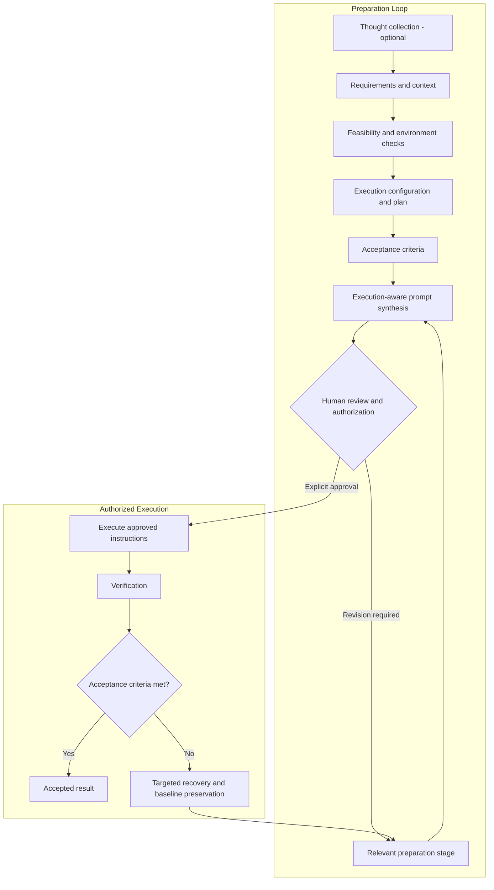

# Collaborative Pre-Prompt Mode for AI Workflows (CPPM)
## A Unified Collaborative AI Workflow Framework

**Proposed by Aenaos — 18 November 2026**  
**Version 0.1 | Technical proposal**

## Abstract

AI systems can execute complex tasks, yet users are frequently expected to supply executable instructions before the objective, constraints, available resources and capabilities of the execution system have been sufficiently established. Collaborative Pre-Prompt Mode (CPPM) proposes a provider-independent framework in which the user and AI jointly prepare an execution-ready prompt and its associated configuration before authorizing execution. The AI contributes not only to understanding the desired outcome but also to identifying the instructions, inputs, tools and operating conditions it or another designated AI system requires. Explicit thought-collection controls, collaborative verification, model and effort recommendations, environment readiness, acceptance criteria, human approval and targeted recovery form a unified workflow. The objective is to minimize total cost to an acceptable result rather than minimize the cost of an isolated inference. This is an architectural proposal, not a validated performance claim.

## 1. Problem statement

Direct prompting places much of the burden of converting an intention into an executable specification on the user. A user may understand the desired outcome without knowing which model, reference assets, software dependencies, execution settings or tests are necessary. Conversely, an AI may generate a plausible plan while lacking reliable knowledge of the actual execution environment. Premature execution can therefore produce avoidable iterations, unnecessary computation and outputs that satisfy the wording of an instruction but not the underlying objective.

The cost of these failures can be particularly significant in video generation, complex software changes and other resource-intensive operations. More preparation is not always better, however: for simple requests, an extended planning dialogue may cost more than direct execution.

CPPM addresses this trade-off by separating collaborative preparation from authorized execution while allowing the depth of preparation to scale with the task.

## 2. Design philosophy and scope

The human defines the intended outcome and retains authority over requirements and authorization. The AI contributes technical knowledge, asks targeted questions, identifies constraints, evaluates alternatives and proposes how the work can best be performed. Both parties may suggest improvements to the collaboration itself.

The central principle is **Execution-Aware Self-Prompt Synthesis**: the AI helps determine what it needs to receive, under which conditions it should operate, and then constructs the instructions that will be returned to it or delivered to the designated execution system. The user reviews those instructions before execution.

CPPM is a workflow and orchestration framework rather than a new model architecture. It does not require changes to model weights, a specific provider, a particular product interface or a particular commercial arrangement. Preparation and execution may occur in the same system or in separate systems. Supported domains can include software development, video and image generation, research, document production and data analysis.

### 2.1 Origin and practical motivation

CPPM originated in repeated practical collaboration between a human user and AI systems. The user would first discuss an idea with an AI, identify gaps, investigate relevant techniques, review existing work and refine requirements. Once the intended outcome and execution conditions were sufficiently clear, the AI would compose an executable prompt for the designated system. The user would review and correct that prompt before authorizing execution.

This approach was motivated by software development and AI video production, where an incomplete instruction can lead to unnecessary implementation or generation attempts. It shifts part of the responsibility for constructing effective instructions from the user to the AI that understands the intended execution process, while preserving human authority over decisions and acceptance criteria.

These practical observations motivated the framework; they do not constitute controlled evidence of efficiency or general effectiveness. Independent evaluation is proposed in Section 9.

## 3. Consolidated functional specifications

The following sixteen requirements define the proposed framework. They describe intended behavior, not demonstrated implementation capabilities.

| ID | Functional area | Specification |
|---|---|---|
| CPPM-01 | Operational Modes | Separate preparation from execution, independently of platform and task type. Preparation may include authorized informational checks but must not silently initiate the target deliverable or irreversible changes. |
| CPPM-02 | Thought Collection | Provide explicit start and completion controls for the user's ongoing contribution. During collection, retain incoming messages without premature substantive analysis, commentary or solutions. |
| CPPM-03 | Objective & Requirements | Establish the user's intended outcome; identify omissions, ambiguities and contradictions; distinguish mandatory requirements, preferences, protected elements and delegated decisions. |
| CPPM-04 | Knowledge & Context Review | Inspect existing work before redesigning it; search for relevant information and practical guidance; review externally produced work when appropriate; assess alternatives and reuse previously verified information when still applicable. |
| CPPM-05 | Capability & Feasibility Assessment | Establish available model capabilities and limitations using reliable information; assess feasibility and communicate uncertainties or feasible alternatives before execution. |
| CPPM-06 | Resource & Environment Readiness | Establish required applications, tools, versions, SDKs, libraries, runtimes, dependencies, permissions, files and reference assets or generation ingredients. Verify availability in the actual intended environment. |
| CPPM-07 | Execution Configuration | Recommend an execution model, computational effort where supported, execution environment and debugging environment. Consider quality, compatibility, privacy, available resources and cost. |
| CPPM-08 | Cost & Complexity Optimization | Scale preparation to complexity, risk and execution cost; prefer the simplest sufficient solution; estimate total cost or a range where reliable information permits. |
| CPPM-09 | Execution Planning | Divide complex work into ordered, controllable stages; define dependencies and mandatory stop points for human confirmation where needed. |
| CPPM-10 | Acceptance & Deliverables | Define expected deliverables, acceptance criteria, verification procedures and the format of the execution report before authorization. |
| CPPM-11 | Execution-Aware Self-Prompt Synthesis | Construct the final prompt after requirements and execution conditions are established. Adapt it to the designated executor and verify completeness, consistency and absence of unnecessary instructions. |
| CPPM-12 | Human Validation & Authorization | Present the complete prompt and proposed execution configuration. Allow review and correction; initiate the target execution only following explicit authorization. |
| CPPM-13 | Failure Recovery & Continuity | Preserve successful elements and working baselines. Diagnose deviations, make targeted corrections and support rollback where the environment permits. Avoid restarting unaffected work. |
| CPPM-14 | State Persistence & Handoff | Preserve agreed requirements, decisions, configuration, progress, evidence and results so that work can continue in another session or compatible AI system. |
| CPPM-15 | Collaborative Verification | Perform checks automatically where authorized and technically possible, or in collaboration with the user. Do not replace missing evidence with unsupported assumptions. |
| CPPM-16 | Bidirectional Optimization | Enable both the user and AI to propose improvements to the collaboration method, task allocation and resource usage, subject to user review. |

## 4. Operational workflow and state controls

### 4.1 Thought collection

The user must be able to indicate explicitly that a train of thought is beginning and that subsequent messages belong to an unfinished contribution. The system should not interpret each fragment as an independent request for a full answer. A completion signal returns the accumulated material to collaborative analysis.

Illustrative control names, pending final approval, are `BEGIN_THOUGHT` and `END_THOUGHT`. Equivalent interface controls may be provided instead. These refer to the user's contribution, not access to hidden model reasoning. A minimal receipt acknowledgment may be used if the interface requires it; substantive processing should be deferred. This interaction contract does not imply zero internal processing or zero storage cost.

### 4.2 Preparation mode

The AI and user establish the objective, review existing context, identify missing information, verify resources, evaluate feasibility and agree on the execution configuration. Research and inspections may occur when authorized. Installing software, changing user files or starting the target generation is not implied by preparation authorization.

### 4.3 Review and authorization

Once the prerequisites are sufficiently established, the AI produces the final prompt and configuration. The user may revise either. Material changes to model, effort, tools, environment or scope require reconsideration of the prompt before approval. Authorization applies to the agreed execution and does not imply unrestricted permission for additional actions.

### 4.4 Execution and verification

The designated execution system receives the approved instructions and configuration. It performs the agreed stages, respects stop points, reports blockers and checks the output against acceptance criteria. Unavailable verification must be reported as such rather than presented as successful testing.

### 4.5 Recovery and continuation

If the result is unacceptable, identify the unmet criteria and retain the successful baseline. Return to the relevant preparation stage, change only what is necessary, and obtain authorization for the revised execution. Handoff should preserve the relevant state rather than require the user to reconstruct it from memory.

Illustrative state flow (not a mandated implementation):



State persistence, collaborative verification and bidirectional optimization apply throughout both modes.

State persistence, collaborative verification and bidirectional optimization apply throughout. The flow is iterative, not a rigid waterfall.

## 5. Execution-aware configuration and synthesis

### 5.1 Capability and environment awareness

The preparatory AI should use available documentation, tool metadata, authorized inspections and user-provided observations to establish what the execution system can do. It must distinguish verified capabilities from assumptions and unknowns. An AI's self-description is not sufficient evidence of a tool's availability or a model's competence.

The environment check may be automatic or collaborative. For example, the AI can inspect an authorized workspace or ask the user to verify an installed application and version. Missing capabilities should lead to a blocker, a proposed remedy or an alternative that the user can evaluate.

### 5.2 Configuration precedes final synthesis

The execution model, effort setting, execution environment and debugging environment are inputs to prompt construction, not merely settings appended afterward. Local debugging may require installation instructions, reproducible commands and user-provided logs. Managed debugging may instead require the executor to run tests inside its available sandbox and report evidence. The recommended model may differ from the preparatory model.

Illustrative configuration:

```yaml
model: Ember # illustrative name, not a verified available model
effort: medium
execution_environment: local
debugging_environment: managed_ai_workspace
required_tools: verified_or_explicitly_unverified
human_authorization: required
```

Settings unsupported by the selected system must be identified as unavailable or not applicable. The framework does not assume that every model exposes an effort setting.

### 5.3 Execution-ready package

The final prompt should incorporate the objective, requirements and exclusions, relevant context and input assets, execution configuration, environment constraints, permitted actions, staged plan, stop conditions, deliverables, acceptance checks and reporting expectations. Information can be supplied through references or structured attachments when supported; it need not be duplicated in a long instruction string.

The user may transfer the prompt manually or authorize a supported handoff. The important property is that the execution instruction is constructed with knowledge of the intended executor and the real conditions of execution.

## 6. Practical examples

### 6.1 Software development: local radio application

A user wants a mobile application for local FM stations with online streams. During preparation, the AI helps identify usable stream endpoints, establish the station list, define the appearance and behavior, review existing code where relevant, and verify the available development tools and target device. The user and AI define whether compilation, installation and debugging occur locally or in a managed coding environment. They agree on tests for playback, station switching and unavailable streams, as well as the expected deliverables.

After these decisions, the AI drafts a complete execution prompt for the coding system. The user reviews it before authorizing implementation. This example is inspired by a user-reported workflow in which a single final coding prompt yielded an application ready for phone testing. It is not a controlled benchmark or a claim that the application passed all tests.

### 6.2 AI video generation: directed scene

A director describes a desired scene, including character positions, camera movement, continuity and visual constraints. Instead of immediately generating video, the preparatory AI identifies ambiguities, checks the documented capabilities of the target generator and recommends the necessary reference images or ingredients. It may advise splitting a scene into shots if a requested continuous movement is unlikely to be supported. Fixed scene elements and acceptance criteria are agreed with the director.

The AI then composes the prompt for the selected video generator, taking its supported inputs and settings into account. The director approves it before generation credits are consumed. If the result violates a continuity requirement, the next attempt preserves the accepted elements and targets that deviation. The expected reduction in failed generations remains a hypothesis to be measured.

## 7. Related work and prior art

CPPM builds on established research and product patterns rather than claiming to invent each component. The following references were checked against accessible publisher, preprint or official project records during preparation on 18 November 2026.

| Related work | Relevant overlap | Distinction in proposed CPPM scope |
|---|---|---|
| Automatic Prompt Engineer (APE) [1] | LLM-generated candidate instructions and selection. | CPPM emphasizes collaborative requirements and verified operating conditions before final execution. |
| ClarifyGPT [2] | Clarifies ambiguous coding requirements and submits refined instructions to the same LLM. | CPPM generalizes beyond code and explicitly incorporates execution configuration and environment readiness. |
| EvalLM [3] and CoPrompter [4] | Interactive evaluation and requirement-derived checks. | CPPM additionally organizes pre-execution preparation, authorization and handoff. |
| PROMST [5] and PromptWizard [6] | Automated prompt improvement using feedback and evaluation. | CPPM treats human–AI preparation and total workflow cost as central, rather than relying solely on candidate-prompt evaluation. |
| PromptPilot [7] | Interactive LLM-assisted prompt engineering. | CPPM explicitly couples prompt synthesis with the proposed model, effort, tools and execution/debugging environments. |
| RouteLLM [8] | Model routing with cost–quality trade-offs. | CPPM treats model selection as one part of a broader user-reviewed execution package. |
| GitHub Spec Kit [9] and Kiro Specs [10] | Structured specification, planning and implementation workflows. | CPPM proposes a cross-domain framework with explicit thought-collection controls and execution-aware self-prompt synthesis. |
| Adaptive Conversation Layer (ACL) [11] | Earlier Aenaos proposal for conversation orchestration and resource allocation. | CPPM focuses on preparation of authorized executable work; ACL focuses on conversation state and progressive response disclosure. |

These distinctions describe the focus of the sources reviewed, not proof that the listed systems lack every other CPPM feature. The combination of explicit thought collection, user–AI requirements discovery, environment-aware configuration, AI-authored executable instructions, authorization and total-cost evaluation is the proposed integration. No claim of legal novelty, priority over all related work, or measured superiority is made. A comprehensive literature and patent review remains outstanding.

## 8. Expected benefits and limitations

Potential benefits include fewer avoidable execution attempts, reduced specification loss, improved compatibility with available tools, clearer human control, more reproducible handoffs and more predictable resource allocation. These are intended outcomes, not established results.

Preparation itself consumes tokens, time and attention. Capability documentation may be incomplete, model recommendations may be wrong, access to the local environment may be unavailable, and generation may remain stochastic even with a well-prepared prompt. Some operations cannot be rolled back. State persistence and handoff can expose sensitive information unless appropriately scoped. The framework must respect existing access restrictions and user authorization; it does not confer additional permissions. Simpler tasks may benefit from direct prompting rather than a full preparation cycle.

## 9. Proposed evaluation methodology

The primary objective is to minimize **total cost to an acceptable result**, including preparation, execution, failed attempts, corrections and verification. Measure those costs over the complete task, not just the final model call. Report monetary cost, tokens, compute or generation credits, elapsed time and human effort separately unless an explicit conversion method has been established. Quality and acceptance must not be sacrificed merely to lower resource use.

A suggested study would compare direct prompting, an existing planning/specification workflow and CPPM under matched task conditions. Include simple and complex software tasks and video-generation tasks. Use the same available tools, starting assets and acceptance criteria; control or record model versions, execution settings and stochastic seeds where available. Where CPPM recommends a different model or effort, report both the configuration and costs, and include a fixed-configuration comparison to separate the effect of preparation from routing.

Suggested metrics:

- Acceptance rate under a fixed budget and first-execution acceptance rate.
- Total tokens, generation credits, monetary cost and available compute measures, including unsuccessful tasks.
- Time to acceptable result, human preparation time and number of interventions.
- Requirement coverage, verification completeness and unauthorized or unintended changes.
- Number of execution attempts, targeted fixes and full restarts.
- User satisfaction and perceived control.

Report failures, censored tasks that exceed the budget, uncertainty and variability rather than measuring only successful cases. An illustrative ablation study could remove thought collection, environment verification, configuration-aware synthesis or authorization/recovery components individually. These are proposed study designs; no empirical results are asserted.

The central hypothesis is that the extra preparation cost can be offset by reduced execution and rework costs in sufficiently complex tasks. The crossover point and actual benefit must be determined experimentally.

## 10. Conclusion

CPPM proposes that AI should participate in preparing the instructions it will execute, rather than expecting users to independently master the prompting conventions and technical limitations of every execution system. The human remains responsible for defining the intended outcome and approving the executable specification. The AI helps determine what information, resources, configuration and instructions are necessary to achieve it.

As a **Unified Collaborative AI Workflow Framework**, CPPM brings established practices together with explicit controls for collaborative preparation and execution-aware self-prompt synthesis. Its value should be assessed by the cost and quality of the complete workflow. The proposal is offered for technical discussion, implementation and independent evaluation.

## References

1. Zhou, Y., et al. (2022). *Large Language Models Are Human-Level Prompt Engineers.* arXiv:2211.01910. https://arxiv.org/abs/2211.01910
2. Mu, F., et al. (2024). *ClarifyGPT: A Framework for Enhancing LLM-Based Code Generation via Requirements Clarification.* Proceedings of the ACM on Software Engineering. https://doi.org/10.1145/3660810
3. *EvalLM: Interactive Evaluation of Large Language Model Prompts on User-Defined Criteria* (2024). CHI 2024. https://doi.org/10.1145/3613904.3642216
4. Joshi, I., et al. (2024). *CoPrompter: User-Centric Evaluation of LLM Instruction Alignment for Improved Prompt Engineering.* arXiv:2411.06099. https://arxiv.org/abs/2411.06099
5. Chen, Y., et al. (2024). *PRompt Optimization in Multi-Step Tasks (PROMST): Integrating Human Feedback and Heuristic-based Sampling.* arXiv:2402.08702. https://arxiv.org/abs/2402.08702
6. Agarwal, E., et al. *PromptWizard: Task-Aware Prompt Optimization Framework.* Microsoft Research, official project and linked paper. https://microsoft.github.io/PromptWizard/
7. Gutheil, N., et al. (2025). *PromptPilot: Improving Human-AI Collaboration Through LLM-Enhanced Prompt Engineering.* arXiv:2510.00555. https://arxiv.org/abs/2510.00555
8. Ong, I., et al. (2024). *RouteLLM: Learning to Route LLMs with Preference Data.* arXiv:2406.18665. https://arxiv.org/abs/2406.18665
9. GitHub. *Spec Kit: Agentic Spec-Driven Development.* Official documentation, accessed 18 November 2026. https://github.com/github/spec-kit/blob/main/docs/reference/agentic-sdd.md
10. Kiro. *Feature Specs.* Official documentation, accessed 18 November 2026. https://kiro.dev/docs/specs/feature-specs/
11. Aenaos (26 May 2026). *Adaptive Conversation Layer Proposal: Structured State Management, Progressive Disclosure, and Engagement-Aware Response Scaling for LLM UX.* OpenAI Developer Community. https://community.openai.com/t/adaptive-conversation-layer-proposal-structured-state-management-progressive-disclosure-and-engagement-aware-response-scaling-for-llm-ux/1381794

## License

Copyright © 2026 Aenaos. The text and specifications of this proposal are licensed under the [Creative Commons Attribution 4.0 International license (CC BY 4.0)](https://creativecommons.org/licenses/by/4.0/). Third-party referenced works remain subject to their respective rights and licenses.
